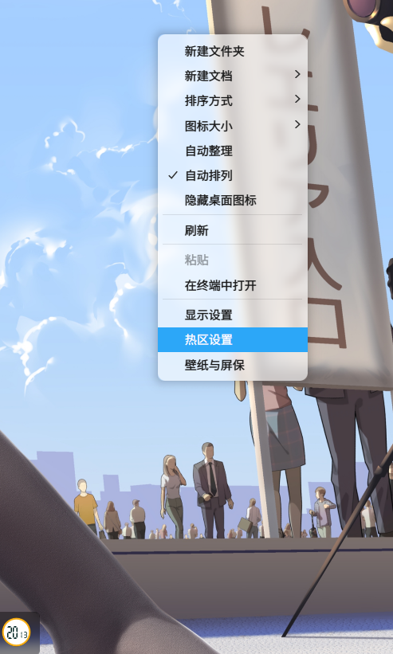

# GXDE Hot Zone

GXDE Hot Zone is a recreation of the hot zones/active corners from the Deepin 15 era. It utilizes the four corners of the screen; moving the mouse to a corner triggers the corresponding function set by the user.

<br />

Now GXDE Hot Zone supports both X11 & Wayland.



<br />

## Build & Run

### Build Via CMake

You will need to have Qt6 and LayerShellQt ready, then:

```Shell
$ mkdir build && cd build
$ cmake ..
$ make
```

<br />

### Build Debian Packaging

You may use the `build-deb` script by simply:

```Shell
$ chmod a+x ./build-deb
$ ./build-deb -d  # Will automatically install dependencies, next time you may use ./build-deb (without the -b) to skip dependency detection.
$ ./build-deb -c  # This cleans up repo and also cleans the .deb artifact.
```

<br />

## Configuration

### Editing Config File

The config file may be found on `$HOME/.config/GXDE/gxde-requ/gxde-requ-setting.qaq`. It's format should be:

```ini
TopLeftShell=
TopRightShell=
LowerLeftShell=
LowerRightShell=
```

<br />

Here is an example:

```ini
TopLeftShell=dbus-send --print-reply --dest=com.deepin.dde.Launcher /com/deepin/dde/Launcher com.deepin.dde.Launcher.Toggle
TopRightShell=/usr/lib/deepin-daemon/desktop-toggle
```

<br />

### Config Using CLI Tool

> This is espcially useful is you are using a desktop environment other than GXDE.

<br />

You may use `gxde-requ-setter` to configure the hot zone behavior, here is the usage:

```Shell
$ /usr/bin/gxde-requ-setter --set <Corner> <Command>  # Change the command for a specific corner.
$ /usr/bin/gxde-requ-setter --clear <Corner>          # Clears the command for a specific corner.
$ /usr/bin/gxde-requ-setter --gui                     # Triggers the GUI manager.
```

<br />

# License

GXDE Hot Zone is licensed under GNU GENERAL PUBLIC LICENSE Version 3, you may find a copy of the license [here](./LICENSE).
